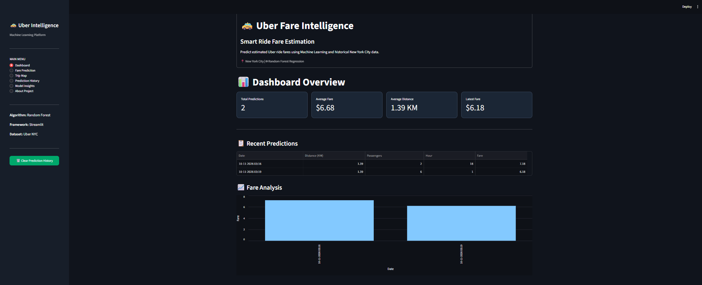
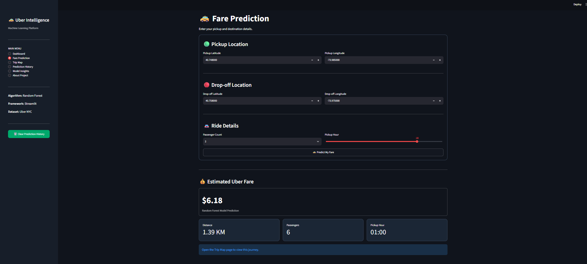
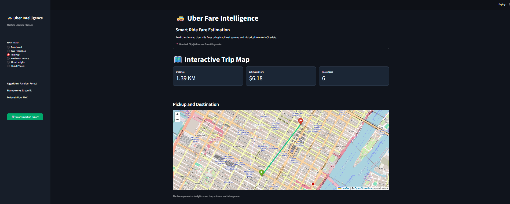
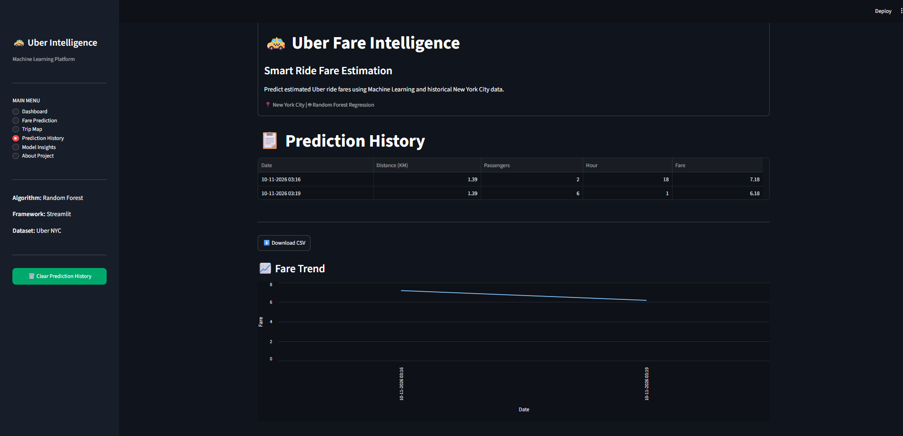
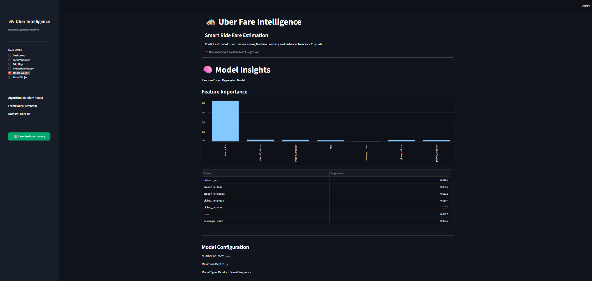
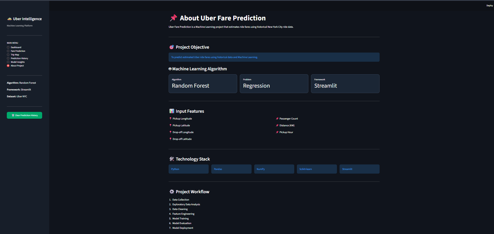

<<<<<<< HEAD
# 🚕 Uber Fare Intelligence

### Machine Learning–Powered Uber Fare Prediction | New York City

A Streamlit web application that estimates Uber ride fares from pickup and drop-off coordinates, passenger count, and pickup hour. It uses a trained **Random Forest Regressor** and visualizes trips on an interactive Folium map.

> **Note:** Predictions are estimates from historical data, not live Uber quotes. Distances use the Haversine (straight-line) formula, not road-network distance.

## ✨ Features

- **Dashboard:** Total predictions, average fare, average distance, latest fare, and recent predictions.
- **Fare Prediction:** Enter pickup/drop-off coordinates, passenger count, and pickup hour to estimate a fare in USD.
- **Trip Map:** Interactive OpenStreetMap map with pickup and destination markers and a straight-line connection.
- **Prediction History:** View predictions, analyze trends, and export history as CSV.
- **Model Insights:** Inspect Random Forest feature importance and model configuration.
- **About Project:** Review objectives, input features, technology stack, and workflow.

## 🖼️ Application Screenshots

### Dashboard


### Fare Prediction


### Interactive Trip Map


### Prediction History


### Model Insights


### About Project


## 🛠️ Tech Stack

| Area | Technology |
| --- | --- |
| Programming | Python |
| Data manipulation | Pandas, NumPy |
| Machine learning | Scikit-learn (Random Forest Regressor) |
| Model persistence | Joblib |
| Web application | Streamlit |
| Maps | Folium, streamlit-folium, OpenStreetMap |

## 🧠 Machine Learning

**Problem:** Supervised regression — estimate a numerical fare amount.

**Model:** Random Forest Regressor, loaded from `models/uber_fare_model.pkl`.

**Input features used by the current application:**

| Feature | Description |
| --- | --- |
| `pickup_longitude` | Pickup longitude |
| `pickup_latitude` | Pickup latitude |
| `dropoff_longitude` | Destination longitude |
| `dropoff_latitude` | Destination latitude |
| `passenger_count` | Number of passengers |
| `distance_km` | Haversine distance between coordinates (km) |
| `hour` | Pickup hour (0–23) |

**Target:** Ride fare in USD.

The app aligns input columns with `model.feature_names_in_` when available. Any preprocessing used during training must also be applied at inference time; ideally save preprocessing and estimator together as a scikit-learn Pipeline.

**Model performance:** Add your actual test-set MAE, RMSE, and R² from the training notebook before publishing performance claims.

## 📁 Project Structure

```text
Uber_Fare_Prediction/
├── app.py
├── README.md
├── requirements.txt
├── data/
│   └── uber-fare-NewYorkCity.csv
├── models/
│   └── uber_fare_model.pkl
├── notebooks/
│   └── Uber_Fare_NewYorkCity.ipynb
└── screenshots/
    ├── dashboard.png
    ├── fare_prediction.png
    ├── trip_map.png
    ├── prediction_history.png
    ├── model_insights.png
    └── about_project.png
```

## 🚀 Installation and Usage

**1. Clone the repository** (replace the placeholder with your repository URL):

```bash
git clone https://github.com/YOUR_USERNAME/YOUR_REPOSITORY.git
cd YOUR_REPOSITORY
```

**2. Create a virtual environment:**

```bash
python -m venv streamlit_env
```

Activate it on **Windows PowerShell**:

```powershell
.\streamlit_env\Scripts\Activate.ps1
```

On **macOS/Linux**:

```bash
source streamlit_env/bin/activate
```

**3. Install dependencies:**

```bash
python -m pip install -r requirements.txt
```

**4. Run the app:**

```bash
streamlit run app.py
```

Open the local URL printed in your terminal (typically `http://localhost:8501`).

### `requirements.txt`

```text
streamlit
pandas
numpy
scikit-learn
joblib
folium
streamlit-folium
```

## 🔄 How It Works

1. The user enters ride coordinates, passenger count, and pickup hour.
2. The app validates coordinates and computes Haversine distance in kilometers.
3. It constructs a model input with the required feature names and order.
4. The saved Random Forest model predicts the estimated fare.
5. The app displays the fare and ride summary, and stores the prediction in session history.
6. The map visualizes the two locations, and history can be exported to CSV.

## ⚠️ Limitations

- Not an official Uber product and not connected to Uber's pricing API.
- Fare estimates may be inaccurate for unusual locations, dates, or conditions outside the training data.
- The map line is **not** a turn-by-turn driving route.
- Prediction history is kept in Streamlit session state; it is not permanent storage.
- OpenStreetMap tiles require an internet connection.
- Load `.pkl` model files only from trusted sources.

## 🔮 Future Improvements

- Add address search/geocoding instead of requiring coordinates.
- Integrate road-route distance and estimated travel time.
- Persist prediction history to a database.
- Evaluate and monitor prediction quality on new data.
- Deploy to Streamlit Community Cloud.

## 👨‍💻 Author

**Shubham Shinde** — Computer Science Engineering | Python, SQL & Machine Learning

- [GitHub](https://github.com/Shinde072707)
- [LinkedIn](https://www.linkedin.com/in/shubham-shinde-8b9774287)
- [Kaggle](https://www.kaggle.com/shindeshubhamgajanan)

---

*Built with Python, Scikit-learn, Streamlit and Folium.*
=======
# Uber-Fare-Prediction
Machine Learning-based Uber fare prediction using Random Forest Regressor, Python, Pandas, NumPy, and Streamlit. Predict ride fares based on pickup and drop-off locations and trip details.
>>>>>>> b3055cfd2ce233ff5c5d4b6058f8c9328dbbda1f
